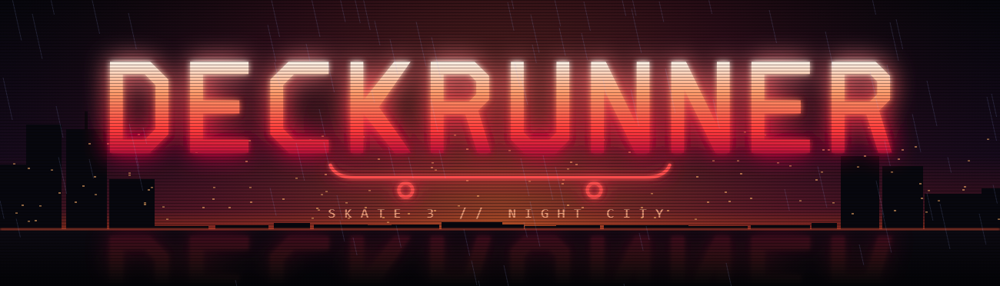

# Deckrunner: Skate 3 in Cyberpunk 2077

Deckrunner puts Skate 3's skating into Night City: Skate's own engine runs beside Cyberpunk 2077, with Flick-It
controls, tricks, grinds, manuals, bails and session markers on Night City's streets, and V riding in third person.

**Download it from Nexus Mods:** https://www.nexusmods.com/cyberpunk2077/mods/38864

It's an unofficial fan project, unaffiliated with Electronic Arts or CD PROJEKT RED. It ships no Skate 3 or Cyberpunk
2077 code or data: a one-time setup builds everything from your own Skate 3 disc and your own game install.

## This repository

For now it hosts the **setup tools** release: the two small programs Deckrunner's setup runs to read your Skate 3
disc (`skate-xma.exe` and `xex_image.exe`, built unchanged from [SK8V](https://github.com/becaring/SK8V) 1.1.10).
Nexus Mods doesn't allow programs in mod files, so the setup downloads them from here and checks them against their
SHA-256. `skate-xma` is LGPL-2.1-or-later; its complete source is inside the zip.

## Licence

Apache License 2.0 (`LICENSE`); `NOTICE` lists the work Deckrunner builds on and its licences.
